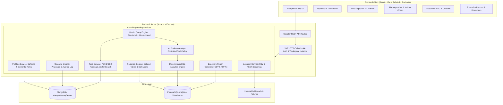

# InsightIQ — Enterprise Decision Intelligence & Analytics Platform

> **InsightIQ** is a production-grade, full-stack Business Intelligence (BI) and Data Analytics platform. It enables enterprise users to upload CSV and Excel datasets, automatically profile schemas and detect data quality issues, store structured data in isolated PostgreSQL analytical tables, compute deterministic metrics and dynamic visual dashboards, interact with an AI Business Analyst via controlled SQL tool calling, and query unstructured governance documents using Retrieval-Augmented Generation (RAG).

---

## 🏗️ Architecture Overview

InsightIQ is architected as a clean modular monorepo separating analytical execution from metadata and vector storage:
- **Application Database (MongoDB)**: Users, Workspaces, Dataset metadata, Column Mappings, Quality Reports, Conversations, Document Chunks & Embeddings.
- **Analytical Warehouse (PostgreSQL)**: Isolated structured analytical tables per workspace/dataset (`ws_{workspaceId}_ds_{datasetId}`) for fast, safe, parameterized SQL computations.
- **Deterministic Analytics Engine**: Descriptive statistics, chronological time series, period comparisons (MoM/YoY), anomaly detection, and customer RFM analytics in SQL & JavaScript (zero hallucinated figures).
- **AI Business Analyst**: Controlled tool-calling system using LangChain / OpenAI specification with a deterministic local engine fallback.
- **RAG Document Pipeline**: PDF & DOCX ingestion, character chunking with overlap, vector embeddings, and semantic similarity search with source citations.
- **Frontend Application**: React 18, Vite, Tailwind CSS, Recharts, Lucide icons, and modern enterprise dark glassmorphism design.



---

## 🚀 Quick Start & Setup Instructions

### 1. Prerequisites
- **Node.js**: v18+ (tested on v24.11.0)
- **PostgreSQL**: v14+ (running on port 5432, default user: `postgres`, password: `root`, database: `insightiq`)
- **MongoDB**: Local MongoDB or MongoDB Atlas URI (Note: If no external MongoDB instance is running, the backend automatically spins up an in-memory `MongoMemoryServer` with zero manual configuration).

### 2. Analytical Database Initialization
Open `psql` or your database console to verify the database exists:
```bash
# In PostgreSQL CLI:
CREATE DATABASE insightiq;
```

### 3. Backend Setup
```bash
cd server

# Install dependencies
npm install

# Copy environment variables
cp .env.example .env

# Run the test suite (verifies all 20 automated tests)
npm test

# Start backend server
npm start
# -> Backend starts on http://localhost:5000
```

### 4. Frontend Setup
```bash
cd client

# Install dependencies
npm install

# Run Vite development server
npm run dev
# -> Frontend starts on http://localhost:3000
```

---

## ⚙️ Environment Variables

### `server/.env`
| Variable | Default Value | Description |
|---|---|---|
| `PORT` | `5000` | Express server port |
| `NODE_ENV` | `development` | Node environment |
| `JWT_SECRET` | `insightiq_super_secure_jwt_secret_key_2026` | Secret key for JWT session tokens |
| `JWT_EXPIRES_IN` | `7d` | Token expiry duration |
| `MONGODB_URI` | `mongodb://127.0.0.1:27017/insightiq` | MongoDB connection URI (Atlas or local) |
| `PG_HOST` | `localhost` | PostgreSQL host |
| `PG_PORT` | `5432` | PostgreSQL port |
| `PG_USER` | `postgres` | PostgreSQL username |
| `PG_PASSWORD` | `root` | PostgreSQL password |
| `PG_DATABASE` | `insightiq` | PostgreSQL database name |
| `OPENAI_API_KEY` | *(empty)* | Optional OpenAI key; if omitted, runs in Deterministic Engine Demo Mode |
| `DEMO_MODE` | `true` | When true or key is absent, executes deterministic tool calling & RAG |
| `CLIENT_URL` | `http://localhost:3000` | Frontend CORS origin |

---

## 📦 Implemented Modules & Features

### Module 1: Authentication & Workspace Isolation
- Signup, login, logout, and current user profile endpoints.
- Secure password hashing using `bcryptjs` and HTTP-only cookie authentication.
- Strict workspace-level data isolation: every dataset, table, document, and chat belongs to an authorized workspace. Cross-workspace access is prevented at the middleware level.

### Module 2 & 3: Ingestion, Profiling & Semantic Mapping
- Supports CSV, XLSX, and XLS file uploads up to 50MB.
- Streaming parsing with preview generation and malformed row handling.
- Deterministic data type inference (`numeric`, `date`, `boolean`, `categorical`, `string`).
- Heuristic semantic role mapping: `revenue`, `cost`, `profit`, `quantity`, `date`, `product`, `category`, `customer_id`, `transaction_id`, `price`, `discount`, `region`, `status`.
- Ambiguity flags, confidence scores (0.0 to 1.0), and manual user override mapping UI.

### Module 4: Data Quality & Cleaning
- Scans for missing values, duplicate rows, invalid dates, and statistical outliers using Interquartile Range (IQR) and Z-score metrics.
- Computes overall Data Quality Health Score (0 to 100).
- Generates actionable cleaning proposals (deduplicate, impute with median/mode, cap outliers) with a review modal before application.
- Keeps an auditable transformation log while preserving original uploaded files intact on disk.

### Module 5 & 6: PostgreSQL Storage & Deterministic Analytics
- Creates isolated physical tables in PostgreSQL: `ws_{workspaceId}_ds_{datasetId}` with length-bounded indexes on text/date columns.
- Parameterized batch insertion and safe data type casting.
- Dataset relationship registry and safe SQL join execution across datasets in the workspace.
- Deterministic calculations:
  - Dataset summaries (Total revenue, volume, AOV, unique customers, date range)
  - Chronological time series trends with granularity selection (Month, Day, Week)
  - Period comparisons with Month-over-Month (MoM) percentage change and trend badges
  - Top & bottom performing products and categories
  - Customer insights (distribution of single vs repeat buyers, top enterprise accounts)
  - Statistical 2-sigma anomaly detection

### Module 7: Dynamic BI Dashboard
- Polished enterprise SaaS dark-mode dashboard with glassmorphism.
- Responsive KPI cards, dynamic Recharts Area/Line time-series, Bar charts, Donut charts for regional distribution, and top product ranking tables.
- Zero hardcoded numbers — all metrics calculated live from PostgreSQL.

### Module 8: AI Business Analyst
- Controlled tool calling system supporting:
  - `getDatasetOverview`, `getBusinessMetrics`, `getRevenueByPeriod`, `getTopCategories`, `comparePeriods`, `getCustomerInsights`, `detectAnomalies`, `getDatasetColumns`, `generateChartData`.
- Executes read-only parameterized analytical queries against PostgreSQL.
- Formats structured business insights and dynamically generates in-chat Recharts visuals.
- Deterministic local engine fallback clearly tagged `[Demo AI Mode: Deterministic Engine]`.

### Module 9: RAG Document Intelligence
- Ingestion of PDF, DOCX, and TXT business governance documents.
- Overlapping character chunking retaining page numbers and document metadata.
- Vector embeddings with high-fidelity local cosine similarity fallback.
- Semantic search returning exact source citations with document names, page numbers, and similarity scores.

### Module 10: Hybrid AI Querying
- Automatically classifies user inquiries into Structured Analytics, Document RAG, or Hybrid.
- Synthesizes empirical numerical facts from PostgreSQL with strategic policy excerpts from documents in a unified response.

### Module 11: Executive Reports & Exports
- Automated business summaries detailing computed metrics, segment rankings, and growth trajectory.
- 1-click Download Dataset CSV.
- 1-click Export Executive PDF Report generated on the fly via `pdfkit`.

### Module 15: Sample Datasets & Demo Mode
- **Retail Sales Transactions** (`retail_sales_transactions.csv`): 1,200 rows of omnichannel retail transactions.
- **Customer Segments** (`customer_segments.csv`): 245 accounts with enterprise credit ratings.
- **Product Catalog** (`product_catalog.csv`): 24 products with SKU, target margin, and cost.
- **Sales Q4 Workbook** (`sales_q4_2024.xlsx`): Multi-column Excel spreadsheet.
- **Sample Business Documents**:
  - `Q3_Strategic_Business_Review.pdf` (Volume discounting thresholds, regional channel distribution)
  - `Customer_Support_SLA_and_Refund_Policy.docx` (1-hour P1 SLAs, hardware warranty, restocking fees)
  - `Annual_Financial_Commentary_2024.pdf` (DSO metrics, credit concentration)

---

## 🧪 Automated Test Execution

Run the comprehensive Jest test suite from `server`:
```bash
npm test
```
**Test Results**:
- `Module 1: Authentication & Workspace Isolation`: 3 tests passed
- `Module 2 & 3: Ingestion, Schema Profiling & Semantic Mapping`: 3 tests passed
- `Module 4: Data Quality Inspection & Cleaning Proposals`: 2 tests passed
- `Module 5 & 6: Analytical PostgreSQL Storage & Deterministic Engine`: 5 tests passed
- `Module 8: AI Business Analyst Controlled Tool Calling`: 2 tests passed
- `Module 9: RAG Document Intelligence Pipeline`: 2 tests passed
- `Module 11: Business Report Generation & Downloads`: 3 tests passed
**Total: 20 passed, 20 total (100% pass rate)**.
